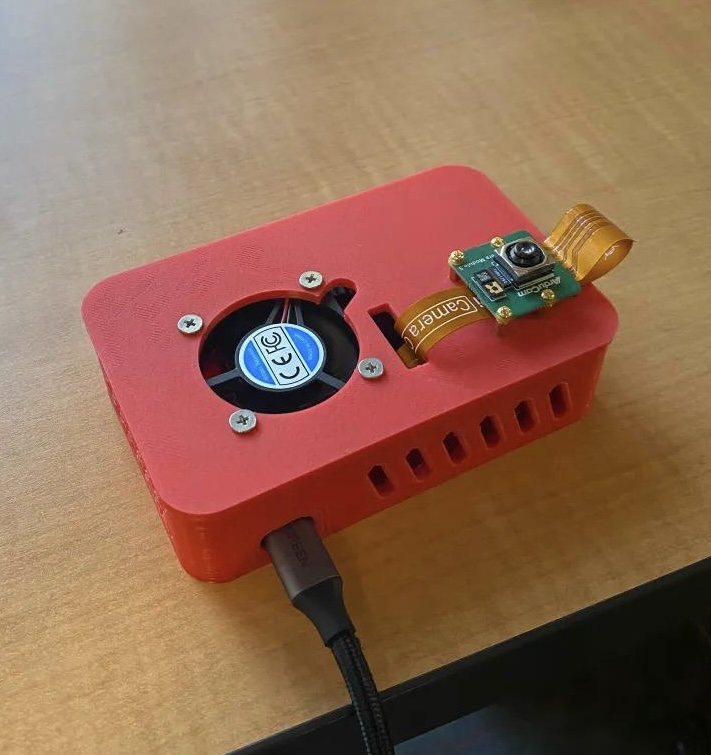
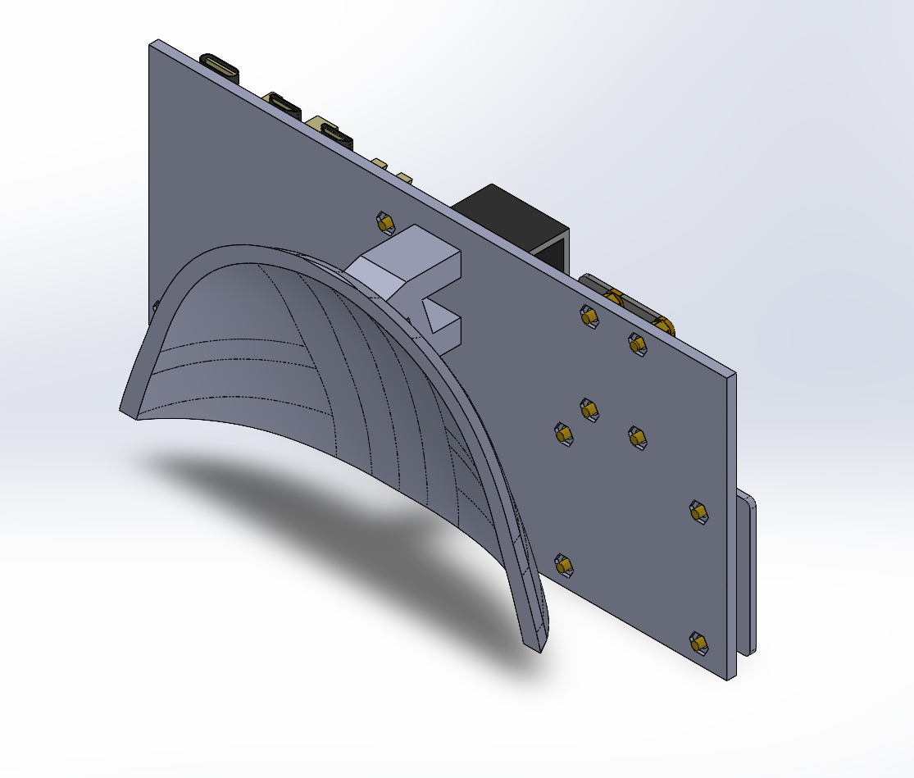
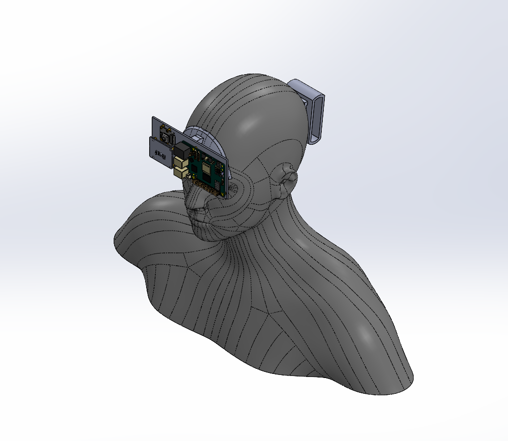

# VisionAssist

**Wearable obstacle detection and spoken navigation for the visually impaired. Runs fully offline on a Raspberry Pi 5.**



*3D-printed enclosure housing a Raspberry Pi 5 and active cooler, with an Arducam IMX708 camera module mounted on the lid.*

---

VisionAssist is a head-mounted device that watches the path ahead, works out what is in the way and roughly how far off it is, then says so out loud through a pair of Bluetooth earbuds. No phone. No cloud. No internet connection. Everything runs on the device.

## Team

Built at De Anza College as an Infineon-sponsored capstone project.

**Aaditya Desai**: software lead. Vision pipeline, distance estimation, audio, web layer.

**Oak** · **Michael** · **Cara** · **Ziyi**

Project advisor: Professor Saied Rafati

## Contents

- [How it works](#how-it-works)
- [What it does well, and what it doesn't](#what-it-does-well-and-what-it-doesnt)
- [Hardware](#hardware)
- [Install](#install)
- [Running it](#running-it)
- [Web interface](#web-interface)
- [Design decisions](#design-decisions)
- [The radar we didn't ship](#the-radar-we-didnt-ship)
- [Reproducibility notes](#reproducibility-notes)
- [Roadmap](#roadmap)
- [Team](#team)
- [License](#license)

---

## How it works

One process, one loop, roughly five frames per second.

```
 IMX708 camera
      │  1280×720 RGB, rotated 90° CCW to match the mount
      ▼
 YOLOv8n  ──────────────  ~200 ms per frame, PyTorch CPU
      │  boxes above 0.45 confidence, blocklisted classes dropped
      ▼
 Distance estimate  ────  from bounding-box height
      │
      ▼
 Risk sort + zone  ─────  most dangerous object becomes "the subject"
      │
      ├──────────────►  Piper TTS  ──►  Bluetooth earbuds
      └──────────────►  Flask  ──►  MJPEG stream + /detections JSON
```

### Distance from a single camera

There is no depth sensor. Distance comes from the pinhole camera relation: an object of known real-world height, seen at a known focal length, projects to a bounding box whose pixel height falls off with distance.

```
distance = real_height × focal_length / bbox_pixel_height
```

`real_height` is a lookup of typical heights for 27 COCO classes (person 1.70 m, chair 0.90 m, car 1.50 m), falling back to 1.0 m for anything not in the table. `focal_length` is 900 px for the 1280 px frame dimension.

That focal length is empirical, not measured. It was tuned down from a theoretical 1435 px to correct an observed overestimate at close range. See [limitations](#what-it-does-well-and-what-it-doesnt) for why that matters.

### Deciding what to say

Not every detection is worth interrupting someone for. Three filters decide:

**Zones**, by estimated distance:

| Zone | Distance | Behaviour |
|---|---|---|
| `SAFE` | > 9.0 ft | Silent |
| `CAUTION` | 6.0 – 9.0 ft | Announce, unless the object is low risk |
| `WARNING` | < 6.0 ft | Announce, prefixed with "stop" |

**Risk tiers**, by object class:

- **High** — furniture and fixed obstacles you can walk into: chair, couch, bed, dining table, door, stairs, refrigerator, oven, sink, toilet
- **Medium** — things that move: person, dog, cat, bicycle, motorcycle, car
- **Low** — everything else

**Subject selection.** Detections are sorted by risk tier first, then by distance within the tier. Only the top one is announced. A chair four feet away outranks a person eight feet away, and a cup on a table never interrupts either of them. This keeps the audio channel clear, which matters a great deal when audio is the only channel the user has.

Speech repeats only when the message changes or a 3-second cooldown expires. Detections persist for 1 second after they disappear, which smooths over YOLO's occasional dropped frames.

---

## What it does well, and what it doesn't

Being straight about this, because an assistive device that overstates its reliability is worse than one that doesn't exist.

**Works:**

- Object identification is solid. YOLOv8n on COCO handles indoor obstacles well.
- The full pipeline runs untethered and offline at ~5 FPS on Pi 5 CPU, no accelerator.
- Spoken alerts are clear, correctly prioritised, and don't spam.
- Latency is low enough for walking pace.

**Known limitations:**

- **Distance is an estimate, and it overestimates.** Especially inside 4 ft. When you get close to an object, YOLO frequently sees only part of it — the top of a chair, a person's torso — so the bounding box is shorter than the object's true height, and a shorter box means the formula reports a larger distance. Exactly backwards from what you want. Zone thresholds were raised to 9/6 ft to compensate, which is a mitigation and not a fix.
- **The real fix is edge-clip detection**, and it isn't implemented. When a bounding box touches the top or bottom edge of the frame the object is partially visible and its distance should be suppressed rather than reported.
- **Focal length was never properly calibrated.** 900 px is a fudge that drags all estimates down. Proper calibration would need a known-height object fully in frame at several measured distances.
- **No error figure exists.** Accuracy was validated by eye, not measured against ground truth. Maximum reliable detection range was never characterised.
- **Height lookup breaks for handheld objects.** A cup on a table and a cup in someone's hand are at very different heights but get the same 0.12 m assumption.
- **No stair or drop-off detection.** A downward step is invisible to this system. This is the single most important gap for real-world use.
- **Bluetooth earbuds must be powered on before the Pi boots**, or ALSA finds no audio device and speech is silently skipped.

This is a proof of concept that demonstrates the pipeline end to end. It is not a safety device and should not be relied on as one.

---

## Hardware

| Component | Notes |
|---|---|
| Raspberry Pi 5 | 8 GB, with official active cooler. Runs ~33 °C under load; without the cooler it hits 82 °C and throttles. |
| Arducam IMX708 | CSI ribbon to the **CAM1** port. Sensor Mode 0: 1536×864 centre crop from the 4608×2592 sensor, scaled to 1280×720. |
| Bluetooth earbuds | Any pair. Developed against JBL Endurance Race 2. |
| Power | USB-C PD, 27 W. The Pi 5 negotiates 5 V only and will not step up to 9 V, so a power bank needs to deliver the wattage at 5 V. USB-A banks are not sufficient. |
| Enclosure | 3D-printed, head-mounted. |



*CAD model of the mount: the Pi 5 stands off a flat carrier plate on hex
spacers, with a curved arch that conforms to the side of the skull.*



*Fit check against a head model — camera forward at temple height.*

Changing the camera sensor mode changes the effective focal length, which invalidates every distance estimate. Don't change it without recalculating.

---

## Install

On a fresh Raspberry Pi OS 64-bit install:

```bash
sudo apt update && sudo apt install -y python3-picamera2 piper
git clone https://github.com/aadityad12/Vision-Assist.git
cd Vision-Assist
python3 -m venv venv --system-site-packages
source venv/bin/activate

# PyTorch CPU build must come first and separately
pip install torch torchvision --index-url https://download.pytorch.org/whl/cpu
pip install -r requirements.txt
```

Model weights and the voice model are not in this repo (see `.gitignore`) because they're large binaries with their own licences. Fetch them into `software/`:

```bash
cd software
# YOLOv8n weights — downloads automatically on first run, or:
python3 -c "from ultralytics import YOLO; YOLO('yolov8n.pt')"

# Piper voice: en_US-lessac-medium (.onnx and .onnx.json)
# from https://github.com/rhasspy/piper
```

Pair the earbuds once and mark them trusted so they reconnect on boot:

```bash
bluetoothctl
scan on          # note the MAC of your earbuds
pair <MAC>
trust <MAC>
connect <MAC>
exit
```

## Running it

```bash
cd software
python3 vision_assist.py
```

To run on boot:

```bash
sudo cp software/visionassist.service /etc/systemd/system/
sudo systemctl daemon-reload
sudo systemctl enable --now visionassist.service
```

The unit assumes the project lives at `/home/assistant/visionassist` with a venv inside it. Edit `User`, `WorkingDirectory`, and `ExecStart` to match your setup. The 10-second `ExecStartPre` delay gives Bluetooth time to reconnect before the first utterance.

Useful:

```bash
sudo systemctl status visionassist.service
journalctl -u visionassist.service -f
```

**If the camera reports "device busy"**, a previous run is still holding it:

```bash
sudo pkill -f vision_assist.py && sudo pkill -f libcamera
```

## Web interface

Flask serves on port 5000 in a daemon thread alongside the detection loop.

| Route | Returns |
|---|---|
| `/` | Minimal page embedding the live stream |
| `/video` | MJPEG stream, annotated: boxes coloured by risk tier, per-object label with confidence, feet and steps, plus a header bar showing subject distance and zone |
| `/app` | Phone web app |
| `/detections` | JSON — the current subject, or `null` |

```json
{
  "labels": ["chair"],
  "subject": {
    "label": "chair",
    "distance_ft": 5.4,
    "steps": 2,
    "zone": "warning"
  }
}
```

The phone app polls `/detections` every 1.5 s and speaks through the Web Speech API, with a 4-second cooldown and re-announcement when the label or zone changes. It exists so a sighted observer can follow along during a demo without stealing the earbuds, and as a fallback audio path.

One quirk worth knowing: iOS Safari won't synthesise speech until an utterance has been triggered by a user gesture, so the app fires a silent one when you tap Connect.

---

## Design decisions

**Distance in steps, not just feet.** "Eight feet" is an abstraction. "Three steps" is something you can act on without doing arithmetic while walking. Conversion is 2.5 ft per step, minimum one step.

**Proactive, not reactive.** Alerts fire while there's still room to change course, not at the moment of contact.

**One object at a time.** Announcing every detection floods the only channel the user has. Rank, pick one, say it.

**No zone jargon in speech.** Early versions said things like "caution, getting close." Replaced with concrete distance, which is more useful and shorter.

**Rule-based fusion.** No learned policy deciding what to announce. Rules are inspectable and debuggable, which matters when the failure mode is someone walking into furniture.

**Offline by design.** Cloud TTS sounds better. It also fails in a basement, on a bad connection, and costs money per utterance. A local neural voice that always works beats a better voice that sometimes doesn't.

The TTS engine went through four candidates before landing: espeak (too robotic), gTTS (needs internet), Coqui (incompatible with Python 3.13), then Piper, which works.

---

## The radar we didn't ship

The project began with an Infineon BGT60TR13C 60 GHz radar on a PSoC 6 AI Kit, intended to supply real distance measurements while the camera supplied identity. It was cut mid-project. The firmware and host-side code are preserved in [`hardware/`](hardware/) with a full write-up of why.

Short version: radar tells you how far away the nearest reflective surface is, but not what it is. Monocular vision tells you what something is, but not reliably how far. Fusing them means answering *"is the thing the radar is ranging the same thing the camera is looking at?"* — which needs 3D spatial localisation, not two sensors reporting numbers. That was out of scope for the timeline. Layered on top were TX-RX antenna leakage, DC offset corrupting the FFT, a hard ~175 cm range ceiling, and an unstable serial link to the Pi.

The PSoC stayed physically mounted through the final demo, as an integration point for future work.

Cutting it was the right call and it is documented here deliberately. Abandoned work that you understand the reasons for is worth more than work you quietly hide.

---

## Reproducibility notes

Two files in `software/` were reconstructed from project documentation rather than recovered from the deployed device, and are marked as such in their headers:

- `tts.py` — faithful to the documented interface (Piper, `en_US-lessac-medium`, `length_scale=1.2`, threaded, non-blocking) but not run on hardware in this exact form
- `visionassist.service` — written from the documented unit configuration

`vision_assist.py` and `app.html` are the deployed versions. One inconsistency survives in them: the Pi speaks `"chair, 3 steps ahead"` while the phone app says `"Chair, 3 steps ahead, 8 ft"`. Same information, different phrasing, because the two were updated at different times. Left as-is rather than silently patched, so the repo matches what was demoed.

---

## Roadmap

Ordered roughly by value per unit of effort.

**Next**
- Edge-clip detection — suppress distance when a box touches a frame edge. Biggest accuracy win available, and it's maybe twenty lines.
- Proper focal length calibration, then re-tune zone thresholds against the measured value.
- Characterise accuracy properly: error bars against ground truth, and a maximum reliable range.

**Later**
- Stair and drop-off detection, likely a downward-facing VL53L1X time-of-flight sensor. The most important missing capability.
- IMU-based tilt correction using the PSoC's BMI270, so head angle stops perturbing distance.
- Swap in a newer YOLO generation for roughly 15% more throughput at equal accuracy.
- Richer scene description from a small local language model, rather than a single object label.

---

## Team

Built by Aaditya Desai at De Anza College, as an Infineon-sponsored capstone project.

Faculty advisor: Professor Saied Rafati

---

## License

MIT, see [LICENSE](LICENSE).

Note that dependencies carry their own terms. Ultralytics YOLOv8 is AGPL-3.0, which affects you if you distribute a modified version of Ultralytics itself. Using it as a library, as this project does, does not impose AGPL terms on this code.
